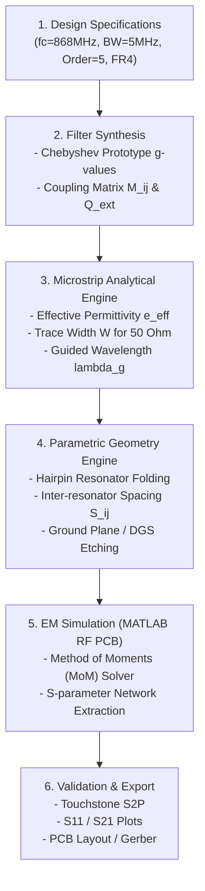

# CubeSat DGS Microstrip Bandpass Filter (Microstrip_DGS)

A specialized MATLAB design, analytical synthesis, and electromagnetic (EM) modeling toolchain for designing miniaturized microstrip bandpass filters with Defected Ground Structures (DGS), targeted for CubeSat communications and LoRa/ISM 868 MHz telemetry.

---

## Features

- **Chebyshev Filter Synthesis**:
  - Closed-form calculation of Chebyshev low-pass prototype element values ($g_0, g_1, \dots, g_{n+1}$).
  - Coupling matrix synthesis ($M_{i,j}$) and external quality factor ($Q_{ext}$) determination for specified fractional bandwidth.
- **Microstrip Transmission Line Engine**:
  - Hammerstad and Wheeler closed-form models for effective relative permittivity ($\varepsilon_{eff}$), characteristic impedance ($Z_0$), guided wavelength ($\lambda_g$), and electrical length ($\theta$).
  - Accurate synthesis of microstrip trace width ($W$) given target impedance $Z_0$ and substrate parameters.
- **Automated Geometry Generation**:
  - Parametric generation of 5th-order hairpin resonators ($\lambda/2$ folded resonators).
  - Inter-resonator coupling gap calculation and input/output tapped or coupled line feed geometry.
  - Defected Ground Structure (DGS) slot patterning and etched ground plane creation.
  - Automated translation into MATLAB RF PCB objects (`pcbComponent` / `microstripLine`).
- **Full-Wave EM Simulation & Analysis**:
  - Integration with MATLAB RF PCB Toolbox and Antenna Toolbox for Method of Moments (MoM) simulation.
  - Extraction and plotting of 2-port Scattering Parameters ($S_{11}$, $S_{21}$, $S_{12}$, $S_{22}$).
  - Center frequency ($F_c$), -3 dB bandwidth, in-band insertion loss, return loss, and selectivity assessment.
- **Touchstone & CAD Export**:
  - Direct export of simulated frequency responses to Touchstone format (`.s2p`) for post-processing and lab comparison.
  - Gerber/DXF layout preparation for PCB manufacturing.

---

## Design Specifications (Reference Design)

| Parameter | Value | Unit | Description |
| :--- | :--- | :--- | :--- |
| **Center Frequency ($f_c$)** | 868 | MHz | ISM / CubeSat LoRa telemetry band |
| **Bandwidth ($BW$)** | 5 | MHz | Passband bandwidth |
| **Filter Order ($N$)** | 5 | — | 5th-order hairpin topology |
| **Filter Type** | Chebyshev | — | Bandpass response with equal ripple |
| **System Impedance ($Z_0$)** | 50 | $\Omega$ | Standard RF port termination |
| **Substrate** | FR4 | — | Standard low-cost fiberglass laminate |
| **Dielectric Constant ($\varepsilon_r$)** | 4.4 | — | Relative permittivity |
| **Loss Tangent ($\tan\delta$)** | 0.02 | — | Dielectric loss factor |
| **Substrate Height ($h$)** | 1.6 | mm | PCB dielectric core thickness |
| **Copper Cladding ($t$)** | 35 | $\mu$m | 1 oz finished copper thickness |
| **Copper Conductivity ($\sigma$)**| $5.8 \times 10^7$ | S/m | Annealed electrodeposited copper |

---

## Architecture & Workflow



---

## Project Structure

```text
CubeSat_Filter/
├── CubeSat_Filter.prj              # MATLAB Project file
├── main.m                          # Master orchestration and design workflow script
├── microstrip.m                    # Microstrip line class and quick utilities
├── substrate.m                     # Substrate material definition and properties
├── line_demo.m                     # Single microstrip transmission line demo
├── hairpin_filter_test.m           # Hairpin resonator coupling simulation test
├── full_filter_test.m              # Complete 5-pole filter EM validation script
├── minimal_test.m                  # Fast sanity verification script
├── check_toolbox.m                 # Verification of required MATLAB toolboxes
├── calculations/                   # Analytical synthesis modules
│   ├── chebyshevPrototype.m        # Chebyshev g-value calculator
│   ├── couplingMatrix.m            # Inter-resonator coupling matrix
│   ├── externalQ.m                 # Input/output external Q factor
│   ├── effectivePermittivity.m     # Hammerstad relative permittivity
│   ├── guidedWavelength.m          # Guided wavelength lambda_g
│   ├── electricalLength.m          # Physical to electrical length mapping
│   ├── microstripWidth.m           # Trace width synthesis
│   ├── microstripImpedance.m       # Characteristic impedance analysis
│   ├── quarterWaveLength.m         # lambda/4 resonator dimensioning
│   ├── resonatorLibrary.m          # Hairpin & stub geometry lookup
│   └── synthesizeFilter.m          # End-to-end filter synthesizer
├── geometry/                       # PCB and RF geometry generation
│   ├── createHairpinResonator.m    # U-shaped hairpin polygon builder
│   ├── createHairpinFilterPCB.m    # Complete multi-pole filter layout
│   ├── createCoupledResonators.m   # Coupled resonator pair layout
│   ├── createGroundPlane.m         # Solid or slotted DGS ground plane
│   ├── createPCB.m                 # Multi-layer dielectric stackup
│   ├── createPorts.m               # RF edge/microstrip port placement
│   └── createTrace.m               # Geometric trace drawing
├── simulation/                     # EM simulation interfaces
│   └── simulateSParameters.m       # Solves S-parameters over frequency sweep
├── validation/                     # Numerical benchmarks and unit checks
├── results/                        # Output plots, S2P Touchstone files, and data
├── resources/                      # Project assets and metadata
└── README.md                       # Project documentation
```

---

## Software & Toolbox Requirements

This project requires **MATLAB R2022b or later** along with the following toolboxes:
- **RF Toolbox**: Transmission line calculations, S-parameter visualization, and Touchstone file operations.
- **RF PCB Toolbox**: Planar EM structure modeling, mesh generation, and Method of Moments electromagnetic solving.
- **Antenna Toolbox**: PCB substrate definitions and polygon geometry generation.
- **Optimization Toolbox** *(optional)*: For automated fine-tuning of inter-resonator coupling gaps and DGS slot dimensions.

Run `check_toolbox.m` from the MATLAB Command Window to automatically verify your installation:
```matlab
check_toolbox
```

---

## Getting Started

1. Open MATLAB and navigate to the project directory:
   ```matlab
   cd /path/to/CubeSat_Filter
   ```
2. Open the MATLAB Project:
   ```matlab
   openProject('CubeSat_Filter.prj')
   ```
3. Run the main design and synthesis pipeline:
   ```matlab
   main
   ```
4. To test only the hairpin resonator coupling:
   ```matlab
   hairpin_filter_test
   ```
5. To execute full-wave EM simulation of the complete 5-pole filter:
   ```matlab
   full_filter_test
   ```

---

## Output Files & Analysis

- **Touchstone S2P**: Exported to `results/` containing magnitude and phase data for 2-port S-parameters across 800 MHz – 1000 MHz.
- **Frequency Response Plots**: Transmission ($S_{21}$) and Return Loss ($S_{11}$) plots highlighting passband insertion loss and harmonic rejection.

---

## License

No license is explicitly defined in this repository. All rights reserved by the author.
